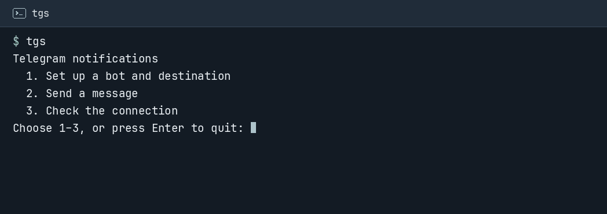

# tgs

`tgs` sends text from your computer to a Telegram chat. Get an alert when an overnight backup fails, read a release summary on your phone, or find out which download just finished.

I made `tgs` for my own use to replace a tool I wrote by hand in Go years ago. I’m not sure why I chose Rust. Maybe I just wanted to see what would happen if I built something with AI in a language that was new to me. Enjoy!

## Send your first message

1. Download and extract the archive for your computer. Choose `apple-darwin` for macOS, `linux-gnu` for Linux, or the Windows `.zip`. Choose `aarch64` for Apple Silicon or ARM64 Linux, and `x86_64` for Intel or AMD. Each archive has a matching SHA-256 checksum. [Download tgs](https://github.com/wanted80/tgs/releases/latest)
2. Open a terminal in the extracted folder. Run `./tgs setup` on Linux or macOS, or `.\tgs.exe setup` in Windows PowerShell. The wizard helps you connect an existing bot or create one. Paste the token at the hidden prompt when asked. [Open BotFather in Telegram](https://t.me/BotFather)
3. For a private chat, open the pairing link on your phone and tap **Start**. Back in the terminal, confirm the destination and accept the test message. You can also choose a group or a channel in the wizard. For a channel, give the bot permission to post.

To use `tgs` from any folder, put it in a directory on your `PATH`. From the extracted folder, use `./tgs` or `.\tgs.exe` instead.

```sh
tgs "Hello from my laptop"
```

Look for the message in Telegram. Add `--verbose` for a receipt in the terminal. If `tgs` opens a menu, choose **2** to see the destination and type a message.



*This recording uses a sample chat and a local stand-in for Telegram.*

## Put it to work

### Get a Telegram alert when a nightly backup fails

In `crontab -e`, adapt your existing backup entry. This one runs at 02:30 daily and alerts you only if the script returns a nonzero exit code. Use your backup script’s path and the full path from `command -v tgs`. Run setup as the user who owns the job. [Crontab syntax](https://github.com/cronie-crond/cronie/blob/master/man/crontab.5)

```cron
30 2 * * * "$HOME/bin/backup" || { rc=$?; /usr/local/bin/tgs --source backup "Nightly backup failed (exit $rc)."; exit "$rc"; }
```

### Read a Codex release summary on your phone

From a Git repository where you use Codex CLI, run this in a Linux or macOS shell. Progress stays in your terminal. When Codex finishes successfully, its final answer goes to Telegram. [Codex CLI scripting guide](https://developers.openai.com/codex/noninteractive/)

```sh
summary=$(codex exec "Summarize the last five commits for our release chat in three short, plain-text bullets.") &&
    printf '%s\n' "$summary" | tgs --source codex
```

### Get the name of a finished rTorrent download

Run `tgs setup` as the user that runs rTorrent. Add this line to that user’s `~/.rtorrent.rc`, substitute the full path to `tgs`, and restart rTorrent. Each completed download sends its name in the background. [rTorrent completion hooks](https://github.com/rakshasa/rtorrent/wiki/Common-Tasks-in-rTorrent#send-email-for-completed-downloads)

```text
method.set_key = event.download.finished,tgs_notify,"execute.nothrow.bg=/usr/local/bin/tgs,--source,rtorrent,--,Downloaded:,$d.name="
```

On a machine named `homeserver`, you’d see this in Telegram.

```text
[rtorrent · homeserver]
Downloaded: debian-netinst.iso
```

### Step away during a long .NET test run on Windows

Save this as `test-and-notify.ps1` in your .NET project and run `.\test-and-notify.ps1` from PowerShell. You get the result on your phone. The full output stays in the terminal, and the script returns the test runner’s exit code. [.NET test command](https://learn.microsoft.com/en-us/dotnet/core/tools/dotnet-test)

```powershell
dotnet test
$testExit = $LASTEXITCODE
if ($testExit -eq 0) {
    tgs --source dotnet "All tests passed."
} else {
    tgs --source dotnet "Test run failed (exit $testExit). Check the test output."
}
exit $testExit
```

## Everyday commands

| What you want to do | Command |
| --- | --- |
| Check which bot and chat are active | `tgs status` |
| Send a long or multiline UTF-8 report | `tgs --file report.txt` |
| Send without a notification sound | `tgs --silent "Backup finished."` |
| Hide the source and computer name from the message | `tgs --no-label "The report is ready."` |
| Set up a separate team chat | `tgs setup team --group` |
| Send to that team chat | `tgs --profile team "The release is live."` |
| See all delivery options | `tgs send --help` |

For an unattended runner, supply `TGS_TOKEN` and `TGS_CHAT_ID` through its secret store, or run `tgs setup` once as its user. The saved configuration contains your bot token. Keep it private. Scripts can request a delivery receipt with `--output json`. If a failure reports partial delivery, check the chat before retrying.

[Contributing](CONTRIBUTING.md) · [MIT license](LICENSE)
